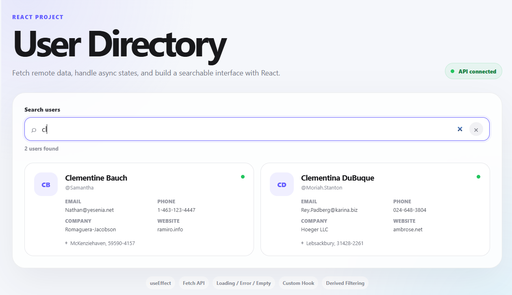

# React Project — User Directory API



This project introduces one of the most important React concepts after state:

**side effects and asynchronous data fetching.**

You will build a user directory that fetches data from the JSONPlaceholder API, handles loading/error/empty states, and filters the resulting users.

## Run

```bash
npm install
npm run dev
```

## Main concepts

- `useEffect`
- `fetch`
- Async/await
- Loading state
- Error state
- Empty state
- Cleanup
- `AbortController`
- Custom hooks
- `useCallback`
- `useMemo`
- Derived state
- `.filter()`
- `.map()`
- Component composition
- API response validation

## The most important concept

This effect runs when the component mounts:

```jsx
useEffect(() => {
  const controller = new AbortController();

  fetchUsers(controller.signal);

  return () => controller.abort();
}, [fetchUsers]);
```

The cleanup function matters because a request can finish after the component is no longer interested in the result.

## Understand the state machine

The hook uses:

```text
idle
 ↓
loading
 ↓
success
```

or:

```text
idle
 ↓
loading
 ↓
error
```

Then the UI decides what to render from `status`.

## Why use a custom hook?

`useUsers()` keeps data-fetching concerns out of `App.jsx`.

The component receives:

```jsx
const { users, status, error, retry } = useUsers();
```

This makes the hook reusable.
